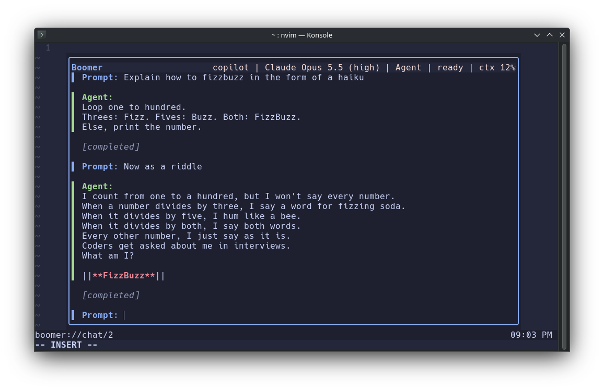

# Boomer

Boomer is a minimalist Neovim agent buffer for adults. No emoji, no animations, no forced UX. It talks to Codex through its App Server protocol, and to GitHub Copilot CLI, Gemini CLI, Claude Agent and other agents through the [Agent Client Protocol](https://agentclientprotocol.com) (ACP). The chat is a native prompt buffer: replies stream in above the prompt while you type the next one.



Boomer requires Neovim 0.12 or newer and an installed, authenticated agent. It has no dependencies and loads lazily. Agents run with your environment, configuration and credentials, and enforce their own sandbox; Boomer never adds auto-approval flags. Full documentation is available via `:help boomer`.

Features include:

*   Chatting with Codex or any ACP agent in a split or floating window.
*   Queuing prompts and setting changes while a turn is running.
*   Changing the model, reasoning effort, mode and permissions from the chat.
*   Resuming saved sessions and switching agents in the same window.
*   Defining your own slash commands and prompt templates.
*   Showing context, token, cost and rate limit usage in the winbar or statusline.

## Configuration

The plugin is configured via the optional `setup` function. Options may be provided to change the default settings shown below; they apply to the next chat.

```lua
require('boomer').setup({
    agent = 'codex',
    agents = {},
    commands = {},
    winbar = true,
    window = { position = 'right', width = 0.5, height = 0.5, float = {} },
    labels = { prompt = 'Prompt:', agent = 'Agent:' },
    signs = { prompt = '▌', agent = '▌' },
})
```

#### `agent`

Specifies which agent profile is started by `:Boomer`. See [Agents](#agents) for the built-in profiles.

#### `agents`

Specifies agent profiles, merged field by field with the built-in ones. Fields given here replace built-in fields of the same name (`args` is replaced, not appended).

```lua
agents = {
    copilot = { model = 'claude-sonnet-4.5', effort = 'high', mode = 'plan' },
    myagent = { protocol = 'acp', command = 'my-agent', args = { 'acp' } },
},
```

A profile supports the following fields:

*   `protocol`: `'codex'` or `'acp'` (required for new profiles)
*   `command`: executable to run (required for new profiles)
*   `args`: list of arguments; Codex always runs `{command} app-server --listen stdio://` followed by `args`
*   `env`: environment variables added to Neovim's environment
*   `model`: model for new sessions (ID or name)
*   `effort`: reasoning effort for new sessions
*   `mode`: mode for new sessions, such as `plan`
*   `options`: table of ACP session config option IDs to values, applied to new sessions
*   `label`: label of the agent's messages, overriding `labels.agent`

#### `commands`

Specifies user slash commands. Mapping a name to `false` disables the built-in command of that name; user commands also override agent commands. A command has a `desc`, an optional `complete` list (or a function returning one), and exactly one of the following:

*   `prompt`: text sent as a prompt, where `$ARGUMENTS` is replaced by the arguments (appended after a blank line otherwise)
*   `run`: a `function(args, ctx)` run in Neovim; `ctx.send(text)` sends a prompt (queued during a turn)

```lua
commands = {
    review = { desc = 'Review the diff', prompt = 'Review `git diff`. $ARGUMENTS' },
    usage = false, -- let the agent handle /usage
},
```

#### `winbar`

Specifies if the chat window's winbar shows the [status](#status). A `function(status)` returning a winbar string may be provided instead.

#### `window`

Specifies how the chat window opens.

*   `position`: `'right'`, `'left'`, `'top'`, `'bottom'` or `'float'`
*   `width`: width of `left`, `right` and `float` windows
*   `height`: height of `top`, `bottom` and `float` windows
*   `float`: extra `nvim_open_win()` config for floats, such as `border` or `title`

Sizes below 1 are fractions of the editor, otherwise a number of cells.

```lua
window = { position = 'float', width = 0.8, height = 0.8, float = { border = 'rounded' } },
```

#### `labels`

Specifies the labels of user and agent messages. The prompt is the user label followed by a space; a profile's `label` overrides `agent`.

#### `signs`

Specifies the signs shown in the sign column next to every line of user messages (and the draft) and agent messages, 1 or 2 cells wide, or `false` to show none. They are drawn by the chat buffer's `statuscolumn`, on every row of wrapped lines, and highlighted with `BoomerUserSign` and `BoomerAssistantSign`, which link to the labels' groups `BoomerUserLabel` and `BoomerAssistantLabel`.

## Agents

Each agent profile names a protocol and the process that speaks it. Built-in profiles expect their executable on `$PATH`, and the agent runs in Neovim's working directory. The `/agent` picker offers the installed ones; run `:checkhealth boomer` to check them.

| Profile    | Command                       | Agent                      |
| -          | -                             | -                          |
| `codex`    | `codex app-server`            | Codex                      |
| `copilot`  | `copilot --acp --stdio`       | GitHub Copilot CLI         |
| `auggie`   | `auggie --acp`                | Augment Auggie CLI         |
| `claude`   | `claude-agent-acp`            | Claude Agent (Claude Code) |
| `cline`    | `cline --acp`                 | Cline                      |
| `cursor`   | `cursor-agent acp`            | Cursor                     |
| `gemini`   | `gemini --acp`                | Gemini CLI                 |
| `goose`    | `goose acp`                   | goose                      |
| `kimi`     | `kimi acp`                    | Kimi CLI                   |
| `kiro`     | `kiro-cli acp`                | Kiro CLI                   |
| `opencode` | `opencode acp`                | OpenCode                   |
| `qwen`     | `qwen --acp`                  | Qwen Code                  |
| `vibe`     | `vibe-acp`                    | Mistral Vibe               |

## Commands

Commands are not mapped by default; an example set of bindings is shown below:

```lua
vim.keymap.set('n', '<Leader>aa', '<Cmd>Boomer<CR>')
vim.keymap.set('n', '<Leader>am', '<Cmd>Boomer model<CR>')
vim.keymap.set('n', '<Leader>ac', '<Cmd>Boomer cancel<CR>')
```

Each command below can be run as `:Boomer {command}` with command-line completion, or typed in the prompt as `/command` with <kbd>Ctrl-X</kbd> <kbd>Ctrl-O</kbd> or <kbd>Ctrl-N</kbd> completion; start the draft with `//` to send a literal `/text`. Commands that take an argument open a picker without one, and commands without an argument refuse one. A command that runs is echoed into the chat as typed, such as `/model gpt-5`, followed by its result, such as `[Setting: model = GPT-5]`; `/new`, `/resume` and `/agent` announce theirs in the new chat buffer, such as `[Session: new]` or `[Agent: copilot]`.

Slash commands advertised by ACP agents (such as Copilot's `/plan`) are sent to the agent; unknown ones are not sent.

#### `Boomer`

Opens or focuses the chat, starting the default agent. If the agent has exited, restarts it in the same window, keeping the draft.

#### `/model [id]`

Sets the session's model by ID or name. Settings change at once, also during a turn; Codex applies them from its next turn. Without such a setting, an agent command of the same name is used, if the agent has one.

#### `/effort [level]`

Sets the reasoning effort.

#### `/mode [mode]`

Sets the session mode, such as `plan` for Codex. Copilot's `/plan` enters plan mode, and only `/mode agent` leaves it.

#### `/permissions [preset]`

Chooses what the agent may do without asking: Read Only, Default or Full Access for Codex; `default`, `assisted` or `allow-all` for Copilot. An agent's own `/permissions` command takes precedence over its permissions setting.

#### `/resume [id]`

Loads a saved session for the working directory; when this starts the agent, dismissing the picker starts a new session. The draft is kept in the new chat buffer, as with `/new` and `/agent`.

#### `/new`

Starts a new session with the same agent.

#### `/agent [name]`

Stops the current agent and starts another profile in the same window.

#### `/compact [focus]`

Summarizes the conversation to free context. Codex compacts between turns only; ACP agents use their own `/compact` command, if they have one.

#### `/usage`

Writes context, token and cost usage into the chat; Codex also shows its 5-hour and weekly rate limits.

#### `/help`

Lists the available commands, including user and agent commands.

#### `/cancel`

Cancels the active turn and returns queued prompts to the draft, like <kbd>Ctrl-C</kbd>.

#### `/close`

Stops the agent and wipes the chat buffer.

## Chat

The chat opens in Insert mode with the cursor after `Prompt: `. A picker opened while you type, such as for `/model` or a permission request, returns to Insert mode once it is answered. The following keys are mapped in the chat buffer only:

| Key                    | Action                                                          |
| -                      | -                                                               |
| <kbd>Enter</kbd>       | Sends the draft or runs the command; queues it during a turn    |
| <kbd>Shift-Enter</kbd> | Adds a line to the draft                                        |
| <kbd>Ctrl-C</kbd>      | Cancels the active turn and returns queued prompts to the draft |
| <kbd>Shift-Tab</kbd>   | Switches to the next session mode                               |

Prompts sent during a turn, or while the session loads, are queued and sent one per turn, in order; they are shown next to the prompt until they are sent, and the prompt's label, sign and text are grayed out meanwhile. Commands are never queued: they run at once. A draft that cannot be sent or run now, such as `/new` during a turn, stays in the prompt, and a warning says why. Errors and warnings are written into the transcript, and are also shown with `vim.notify` while the chat is hidden.

## Status

The chat window's winbar shows a `Boomer` title on the left and the agent, model, mode, state, context use and (for Codex) 5-hour and weekly rate limits on the right:

```
codex | gpt-5 (high) | ready | ctx 42% | 5h 7% | wk 33%
```

Statusline plugins can use `require('boomer').statusline()` or `require('boomer').status()`. The `User BoomerStatus` and `User BoomerTurnDone` autocommands report changes.

## Tests

Run the regression suite from the repository root with Neovim. Fake agents are used, so no login or network is needed:

```sh
make test                   # all tests
make test FILTER=sessions   # tests whose name contains "sessions"
```

Without `make` (on Windows, say), run `nvim --clean --headless -l tests/run.lua [filter]`. Set `NVIM_BIN` to test another Neovim. The fake agents are described in [tests/scenarios/README.md](tests/scenarios/README.md).

Opt-in tests run a real, authenticated agent:

```sh
make test-real BACKEND=codex                                 # no inference
make test-real BACKEND=copilot REAL_ARGS=--allow-inference   # uses quota
```
